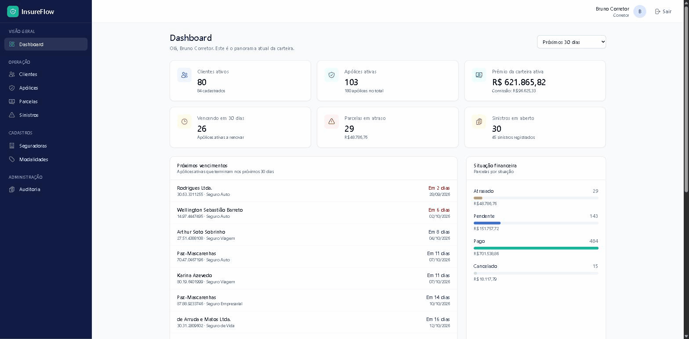
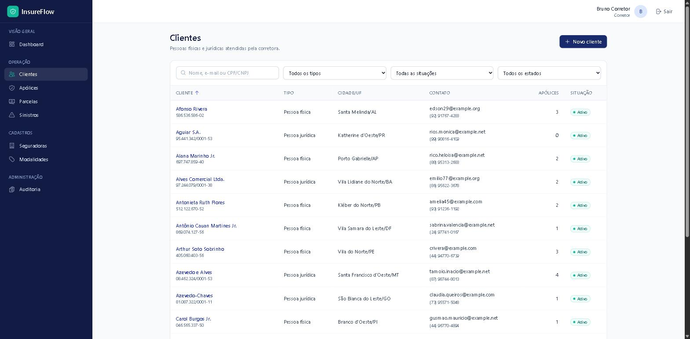
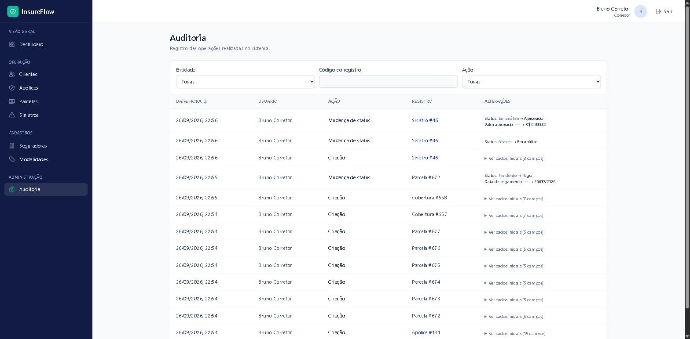

# InsureFlow

Sistema web de gestão para **corretoras de seguros**, desenvolvido como projeto
full-stack: clientes, seguradoras, apólices com coberturas e parcelas, sinistros,
auditoria e um dashboard da carteira. As regras do domínio de seguros são aplicadas
no backend e reforçadas pelo próprio banco de dados.

**Laravel 13 · PHP 8.4 · Vue 3 · PostgreSQL 17 · Docker**



## O problema

Uma corretora acompanha centenas de apólices de várias seguradoras, cada uma com
vigência, parcelas e, às vezes, sinistros em andamento. Em planilhas e e-mails,
renovações passam do prazo, parcelas atrasadas não são percebidas e não há registro
de quem alterou o quê.

O InsureFlow reúne a carteira em um só lugar e garante as regras do negócio:
- status que só mudam por transições válidas;
- parcelas geradas a partir do prêmio;
- comissão calculada pelo banco;
- sinistros aceitos apenas dentro da vigência;
- trilha de auditoria imutável.

## Screenshots

| | |
|---|---|
|  |  |
| **Login** com sessão Sanctum | **Dashboard** com os indicadores da carteira |
|  |  |
| **Clientes** com busca, filtros e ordenação | **Apólice**: dados, valores, coberturas, ações de status e histórico |
|  |  |
| **Sinistro** com fluxo de análise e histórico de status | **Auditoria** das operações com usuário e alterações |

Todas as telas mostram os dados fictícios gerados pelos seeders.

## Demonstração

Roteiro de cerca de 5 minutos para apresentar o sistema, usando a conta de corretor
(veja [Contas de demonstração](#contas-de-demonstração)):

1. **Login** com `corretor@insureflow.test`.
2. **Dashboard**: indicadores calculados no banco. Clique em "Vencendo em 30 dias"
   para abrir a listagem de apólices já filtrada.
3. **Clientes**: busque um cliente e abra o detalhe (apólices e histórico). Clique em
   **Nova apólice**.
4. **Apólice**: escolha seguradora e modalidade, informe prêmio, comissão (%),
   forma de pagamento e 6 parcelas, com a situação **Ativa**. Ao salvar, a página da
   apólice mostra as parcelas geradas e a comissão calculada pelo banco. As ações de
   status oferecem apenas as transições válidas (não aparece "expirar" antes do fim
   da vigência).
5. **Cobertura**: em "Coberturas", **Adicionar cobertura** com nome e limite.
6. **Parcela**: **Registrar pagamento** na 1ª parcela.
7. **Sinistro**: **Abrir sinistro**, com data de ocorrência dentro da vigência. No
   sinistro, avance para **Em análise** e depois **Aprovado**, que pede o valor
   aprovado. O histórico de status registra cada passo.
8. **Auditoria**: veja cada operação da sessão, com usuário, data e campos alterados.
9. *(Opcional)* Entre como `assistente@insureflow.test`: o menu e os botões mudam
   conforme o perfil, e o backend recusa (403) o que o perfil não permite.

A auditoria começa vazia após o seed (os seeders não disparam eventos). O passo 8
mostra o que foi feito durante a demonstração.

## Funcionalidades

**Autenticação e segurança**
- Login por sessão com Laravel Sanctum (cookie HttpOnly + CSRF), logout e sessão expirada.
- Três perfis (administrador, corretor, assistente) com permissões aplicadas no backend.
- Rotas protegidas na API e na SPA; conta desativada perde o acesso na requisição seguinte.

**Gestão**
- Clientes (pessoa física e jurídica), com CPF/CNPJ validado por dígito verificador.
- Seguradoras e modalidades de seguro.
- Usuários (administração exclusiva do administrador).

**Apólices**
- Cadastro com vigência, prêmio, franquia, forma de pagamento e coberturas.
- Parcelas geradas a partir do prêmio, com registro de pagamento.
- Comissão calculada a partir da taxa.
- Transições de status: cotação, pendente, ativa, suspensa, cancelada, expirada.

**Sinistros**
- Abertura com protocolo sequencial, restrita à vigência da apólice.
- Análise, documentação pendente, aprovação (com valor) ou negação, e encerramento.
- Histórico de status com usuário e observações.

**Operação**
- Dashboard: clientes, apólices ativas, prêmio e comissão, vencimentos próximos, parcelas por situação, sinistros em aberto e distribuição por modalidade.
- Consulta financeira de parcelas, com atraso identificado automaticamente.
- Auditoria de todas as operações.
- Expiração automática diária das apólices com vigência encerrada.
- Busca, filtros, ordenação e paginação em todas as listagens.

## Stack

| Categoria | Tecnologias |
|---|---|
| Backend | PHP 8.4 · Laravel 13 · Laravel Sanctum |
| Frontend | Vue 3 (JavaScript, Composition API) · Vite · Vue Router · Pinia · Axios · Tailwind CSS 4 · Chart.js |
| Banco de dados | PostgreSQL 17 |
| Infraestrutura | Docker · Docker Compose · nginx · PHP-FPM |
| Testes e qualidade | PHPUnit · Vitest · @vue/test-utils · Laravel Pint |

## Arquitetura

```text
Navegador
   │
   ▼
nginx ──────────► PHP-FPM · Laravel
                     ├── API REST (/api/*) ── Form Requests → Controllers → Services → Models → Resources
                     ├── Sanctum (sessão + CSRF)
                     ├── Policies (autorização por perfil)
                     └── view que carrega a SPA
                              │
                              ▼
                        PostgreSQL (constraints, coluna gerada, triggers)

SPA Vue ── Axios (camada api/) ──► API Laravel

scheduler ── php artisan schedule:work ──► expiração diária de apólices
```

- **Um monólito, duas camadas.** O Laravel expõe a API e entrega a página da SPA. O
  Vue só se comunica pela API. Estar no mesmo domínio permite autenticar por sessão,
  sem tokens no navegador e sem CORS.
- **Backend como fonte da verdade.** A SPA recebe do servidor as permissões do
  usuário, os rótulos dos enums e quais ações são possíveis em cada registro, e não
  replica regras de negócio.
- **Banco como última linha de defesa.** Invariantes críticas são garantidas por
  constraints do PostgreSQL, não apenas pela aplicação.
- **Docker** sobe o ambiente completo (nginx, PHP-FPM, scheduler, PostgreSQL e Node).

Detalhes: [docs/architecture.md](docs/architecture.md) · Decisões e motivos:
[docs/decisions.md](docs/decisions.md).

## Domínio

```text
Cliente ──< Apólice >── Seguradora
               │  └──── Modalidade, Corretor (usuário)
               ├──< Cobertura
               ├──< Parcela
               └──< Sinistro ──< Histórico de status

Auditoria ──> qualquer entidade
```

A **apólice** é a entidade central: liga cliente, seguradora, modalidade e corretor,
e concentra coberturas, parcelas e sinistros. Clientes, seguradoras, modalidades,
apólices, sinistros e usuários usam exclusão lógica. Regras completas:
[docs/domain-rules.md](docs/domain-rules.md).

## Regras de negócio

- **Transições controladas**: cada status só pode ir para os permitidos pelo enum; as
  condições de data também contam (só expira depois do fim da vigência).
- **Parcelas geradas pela apólice**: quando a cotação é emitida, o prêmio é dividido
  em centavos, com o arredondamento na 1ª parcela, e a soma sempre fecha. As parcelas
  são regeneradas se o prêmio mudar antes de qualquer pagamento, e as pendentes são
  canceladas junto com a apólice.
- **Comissão calculada pelo banco**: `prêmio × taxa` como coluna gerada do PostgreSQL.
- **Atraso derivado**: uma parcela está atrasada quando está pendente e o vencimento
  passou. O status é calculado na consulta, nunca gravado.
- **Sinistros limitados à vigência**: só para apólice ativa, ou expirada se a
  ocorrência foi durante a vigência. O protocolo é sequencial por ano, protegido
  contra concorrência.
- **Histórico de status** imutável para cada sinistro.
- **Expiração automática**: tarefa diária, idempotente, que expira apólices vencidas.
- **Auditoria** automática das operações, com usuário e campos alterados.

## Segurança

- **Sanctum SPA**: sessão em cookie HttpOnly, proteção **CSRF** e sessão regenerada
  no login; nenhum token no navegador.
- **Autorização no backend** por Policies, testada para cada perfil em todas as
  operações de escrita.
- **Rate limiting**: 5 tentativas de login por minuto (e-mail + IP) e 180 requisições
  autenticadas por minuto por usuário.
- **Validação** em Form Requests, com filtros, ordenação e paginação por lista
  permitida.
- **Mass assignment**: campos controlados pelo sistema (status, protocolo, comissão,
  perfil) são recusados ou ignorados.
- **Identificadores de rota** restritos a números (entrada inválida → 404, nunca 500).
- **Headers de segurança** no nginx e erros em português sem detalhes internos.
- **Auditoria imutável** (trigger no banco, sem rotas de escrita).
- **Constraints do PostgreSQL** para valores, datas, status e unicidade.

## Testes

| Suíte | Resultado |
|---|---|
| Backend (PHPUnit, sobre PostgreSQL) | **208 testes, 1.150 asserções** |
| Frontend (Vitest) | **59 testes** |

O backend cobre:
- constraints do banco e regras de negócio;
- cada endpoint;
- autenticação e a matriz de autorização por perfil;
- mass assignment e auditoria;
- scheduler e número de queries (proteção contra N+1).

O frontend cobre:
- o cliente HTTP (401, 419, 422) e os guards;
- formulários, listagens, transições de status e pagamento;
- estados de erro e de lista vazia;
- acessibilidade (foco, rótulos, modal).

```bash
docker compose exec app php artisan test          # backend
docker compose exec node npm test                 # frontend
docker compose exec node npm run build            # build de produção
docker compose exec app vendor/bin/pint --test    # estilo do código PHP
```

## Como executar

**Requisito:** apenas Docker com Docker Compose v2 (no Windows ou macOS, o Docker
Desktop). Não é preciso ter PHP, Composer, Node ou PostgreSQL instalados.

```bash
git clone <url-do-repositorio> insureflow
cd insureflow
cp .env.example .env

docker compose up -d --build
docker compose exec app composer install
docker compose exec app php artisan key:generate
docker compose exec app php artisan migrate --seed
```

Acesse **http://localhost:8000**.

- Na primeira execução, o container `node` instala as dependências do frontend.
  O Vite pode levar alguns minutos para ficar pronto; acompanhe com
  `docker compose logs -f node` até aparecer `ready in`. Antes disso a página fica
  em branco.
- O container `scheduler` reinicia sozinho até o `composer install` terminar; é esperado.
- Portas ocupadas? Ajuste `APP_PORT`, `VITE_PORT` e `FORWARD_DB_PORT` no `.env`. Ao
  mudar `APP_PORT`, atualize também `APP_URL` e `SANCTUM_STATEFUL_DOMAINS`.

Comandos do dia a dia, configuração, depuração e solução de problemas:
[docs/development.md](docs/development.md).

### Contas de demonstração

O seed cria dados **fictícios** (cerca de 180 apólices, parcelas, sinistros e
histórico de status) com datas relativas ao dia da execução, e três contas:

| Perfil | E-mail |
|---|---|
| Administrador | `admin@insureflow.test` |
| Corretor | `corretor@insureflow.test` |
| Assistente | `assistente@insureflow.test` |

A senha das três é o valor de `SEED_DEFAULT_PASSWORD` no seu `.env`. O `.env.example`
traz o valor `password`, apenas para uso local. Os seeders se recusam a rodar com
`APP_ENV=production`.

## Documentação

| Documento | Conteúdo |
|---|---|
| [docs/architecture.md](docs/architecture.md) | Camadas, banco, frontend, Docker, segurança, produção e limitações conhecidas |
| [docs/decisions.md](docs/decisions.md) | Decisões técnicas: problema → decisão → motivo → consequência |
| [docs/domain-rules.md](docs/domain-rules.md) | Entidades, transições, parcelas, sinistros, auditoria e onde cada regra é garantida |
| [docs/api.md](docs/api.md) | Autenticação, perfis, rotas, filtros e formato das respostas |
| [docs/development.md](docs/development.md) | Ambiente Docker, comandos, convenções, depuração e solução de problemas |
| [docs/interview.md](docs/interview.md) | Perguntas e respostas sobre as decisões do projeto |
| [CHANGELOG.md](CHANGELOG.md) | Histórico de versões |

## Licença

[MIT](LICENSE)
