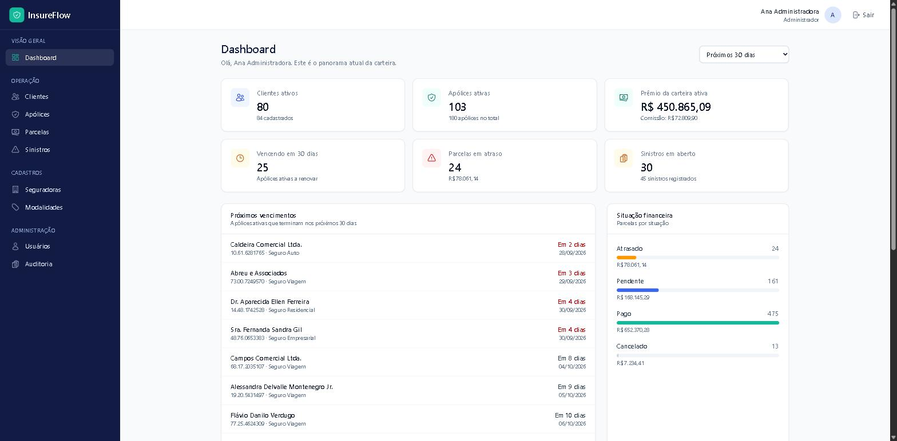
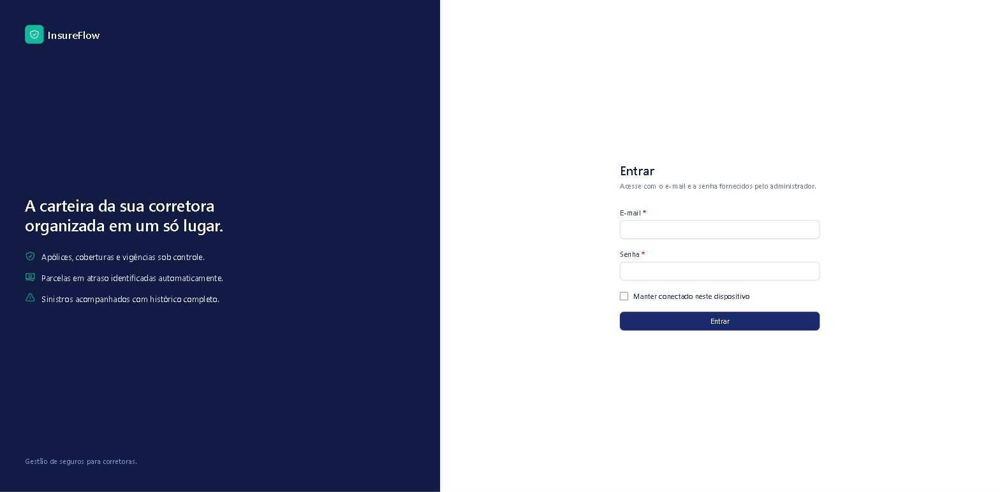
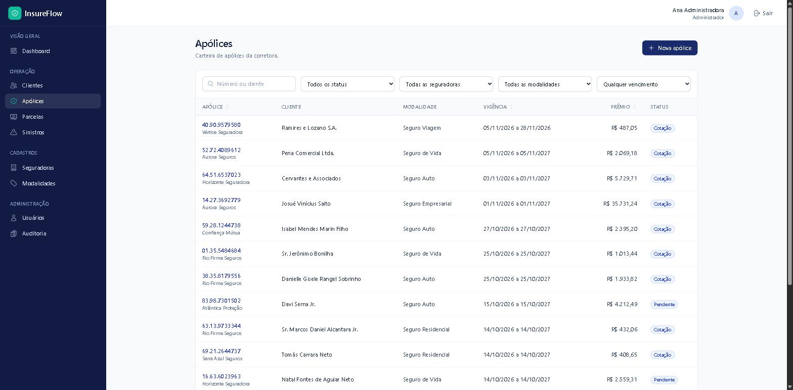
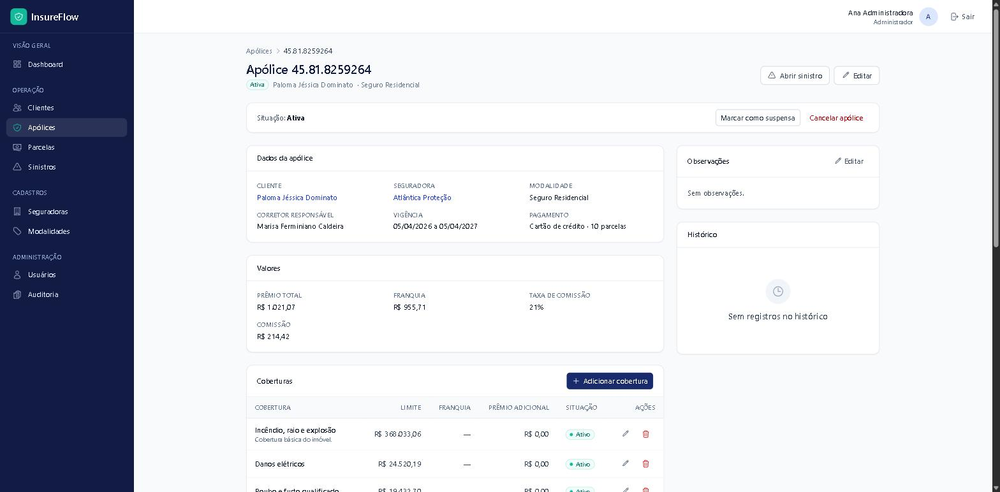
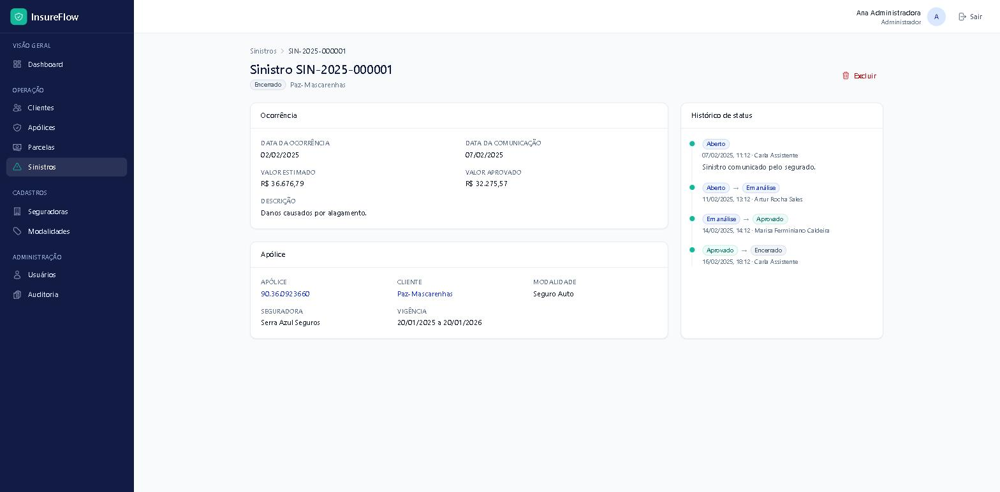

# InsureFlow

Sistema web de gestão para **corretoras de seguros**: clientes, seguradoras,
modalidades, apólices com coberturas e parcelas, sinistros, usuários, auditoria e um
dashboard com os indicadores da carteira.



## O problema

Uma corretora acompanha dezenas ou centenas de apólices de várias seguradoras, cada
uma com vigência, parcelas e, às vezes, sinistros em andamento. Sem um sistema, essa
informação fica espalhada em planilhas e e-mails: renovações passam do prazo, parcelas
atrasadas não são percebidas e não há registro de quem alterou o quê.

O InsureFlow reúne a carteira em um só lugar e aplica as regras do negócio no
backend: status que só mudam por transições válidas, parcelas geradas a partir do
prêmio, comissão calculada pelo banco, sinistros aceitos apenas dentro da vigência e
uma trilha de auditoria imutável.

## Funcionalidades

- **Dashboard** com clientes ativos, apólices ativas, prêmio e comissão da carteira,
  vencimentos próximos, parcelas por situação, sinistros em aberto e distribuição por
  modalidade.
- **Clientes** (pessoa física e jurídica), com CPF/CNPJ validado por dígito verificador,
  endereço, apólices vinculadas e histórico.
- **Seguradoras** e **modalidades de seguro**.
- **Apólices**: cadastro com coberturas, transições de status, geração automática de
  parcelas, comissão calculada, registro de pagamentos e visão central com parcelas,
  coberturas, sinistros e histórico.
- **Parcelas**: consulta financeira de todas as apólices, com parcelas atrasadas
  identificadas automaticamente.
- **Sinistros**: abertura com protocolo sequencial, fluxo de análise e decisão, e
  histórico completo de status.
- **Usuários** com três perfis (administrador, corretor, assistente) e permissões
  aplicadas no backend.
- **Auditoria** de toda criação, alteração, exclusão e mudança de status.
- **Expiração automática** das apólices com vigência encerrada, por tarefa agendada.

## Stack

| Camada | Tecnologias |
|---|---|
| Backend | PHP 8.4 · Laravel 13 · Laravel Sanctum (SPA, sessão + CSRF) |
| Frontend | Vue 3 (JavaScript, Composition API) · Vue Router · Pinia · Axios · Vite · Tailwind CSS 4 · Chart.js |
| Banco de dados | PostgreSQL 17 |
| Infraestrutura | Docker · Docker Compose · nginx · PHP-FPM |
| Qualidade | PHPUnit · Vitest · @vue/test-utils · Laravel Pint |

## Arquitetura

```
Navegador ──> nginx ──> PHP-FPM (Laravel: API REST + view da SPA) ──> PostgreSQL
                              │
                              └─ scheduler: expiração diária de apólices
```

- **Laravel** expõe uma API REST em `/api/*` e entrega a página que carrega a SPA.
- **Vue** é uma SPA que consome apenas a API. O backend é a fonte da verdade: a SPA
  recebe do servidor as permissões do usuário, os rótulos e até quais ações são
  possíveis em cada registro, sem replicar regras de negócio.
- **Sanctum** autentica por sessão em cookie HttpOnly com CSRF, sem tokens no navegador.
- **Camadas do backend**: Form Requests (validação e autorização) → Controllers finos
  → Services (onde há regra de negócio) → Models → API Resources.
- **PostgreSQL** garante as invariantes com constraints, coluna gerada e triggers,
  não apenas a aplicação.
- **Docker** sobe o ambiente completo; nada precisa ser instalado na máquina além dele.

Detalhes e decisões: [docs/architecture.md](docs/architecture.md).

## Domínio

| Entidade | Papel |
|---|---|
| Cliente | Pessoa física ou jurídica atendida pela corretora |
| Seguradora | Companhia que emite as apólices |
| Modalidade | Tipo de seguro (Auto, Residencial, Vida...) |
| **Apólice** | Entidade central: vigência, prêmio, comissão, corretor e status |
| Cobertura | Garantia contratada na apólice |
| Parcela | Divisão do prêmio em pagamentos mensais |
| Sinistro | Ocorrência comunicada sobre uma apólice |
| Usuário | Administrador, corretor ou assistente |
| Auditoria | Registro imutável das operações e do histórico de status |

## Regras de negócio importantes

- **Transições de status**: a apólice segue cotação → pendente → ativa ⇄ suspensa →
  expirada, e pode ser cancelada enquanto não estiver em estado final. Sinistros
  seguem aberto → em análise ⇄ documentação pendente → aprovado/negado → encerrado.
- **Parcelas**: geradas quando a cotação é emitida, em centavos, com a diferença de
  arredondamento na 1ª parcela, para que a soma seja sempre igual ao prêmio.
  Regeneradas se o prêmio mudar antes de qualquer pagamento.
- **Comissão**: `prêmio × taxa`, calculada pelo PostgreSQL como coluna gerada; não há
  como gravar um valor divergente.
- **Atraso**: uma parcela está atrasada quando está pendente e o vencimento passou.
  O status é calculado, nunca gravado, então nunca fica desatualizado.
- **Sinistros**: só para apólice ativa, ou expirada quando a ocorrência foi durante a
  vigência. Protocolo sequencial por ano, protegido contra concorrência.
- **Expiração automática**: tarefa diária expira apólices com vigência encerrada, de
  forma idempotente.
- **Auditoria**: automática e imutável, com o usuário responsável e apenas os campos
  alterados (nunca senhas).

Regras completas e onde cada uma é garantida: [docs/domain-rules.md](docs/domain-rules.md).

## Screenshots

| | |
|---|---|
|  |  |
| **Login** | **Listagem de apólices** com filtros e ordenação |
|  |  |
| **Visão central da apólice** com ações de status | **Sinistro** com histórico de status |

As telas mostram os dados fictícios gerados pelos seeders.

## Como executar

**Requisito:** apenas Docker com Docker Compose v2 (Docker Desktop no Windows/macOS).
Não é preciso ter PHP, Composer, Node ou PostgreSQL instalados.

```bash
git clone <url-do-repositorio> insureflow
cd insureflow
cp .env.example .env

docker compose up -d --build
docker compose exec app composer install
docker compose exec app php artisan key:generate
docker compose exec app php artisan migrate --seed
```

Acesse **http://localhost:8000**.

- O container `node` executa `npm install` ao subir; na primeira vez o Vite pode levar
  alguns minutos para ficar disponível (`docker compose logs -f node`).
- O `scheduler` reinicia sozinho até o `composer install` terminar.
- Se uma porta estiver ocupada, ajuste `APP_PORT`, `VITE_PORT` ou `FORWARD_DB_PORT`
  no `.env` (e `APP_URL`/`SANCTUM_STATEFUL_DOMAINS` junto com `APP_PORT`).

### Usuários de demonstração

Os seeders criam dados **fictícios** (cerca de 180 apólices, parcelas, sinistros e
histórico) com datas relativas ao dia da execução, e três contas de demonstração:

| Perfil | E-mail |
|---|---|
| Administrador | `admin@insureflow.test` |
| Corretor | `corretor@insureflow.test` |
| Assistente | `assistente@insureflow.test` |

A senha é o valor de `SEED_DEFAULT_PASSWORD` no seu `.env` (o `.env.example` traz um
valor padrão apenas para uso local). Os seeders se recusam a rodar com
`APP_ENV=production`.

## Testes

```bash
docker compose exec app php artisan test    # backend (PHPUnit, banco insureflow_test)
docker compose exec node npm test           # frontend (Vitest)
docker compose exec node npm run build      # build de produção
docker compose exec app vendor/bin/pint --test   # estilo de código PHP
```

| Suíte | Resultado atual | O que cobre |
|---|---|---|
| Backend | **208 testes, 1149 asserções** | Constraints do PostgreSQL, regras de negócio, cada endpoint, autenticação, matriz de autorização por perfil, mass assignment, auditoria, scheduler, número de queries (N+1) |
| Frontend | **58 testes** | Cliente HTTP (401/419/422), guards, formulários, listagens, transições de status, pagamento de parcela, estados de erro/vazio, acessibilidade (foco, rótulos, modal) |

Os testes do backend rodam em um banco PostgreSQL separado, criado automaticamente
na primeira inicialização, para exercitar as constraints reais.

## Comandos úteis

```bash
docker compose up -d                                   # sobe o ambiente
docker compose down                                    # para (mantém o banco)
docker compose down -v                                 # para e APAGA os volumes
docker compose exec app php artisan migrate:fresh --seed   # recria o banco com dados de demonstração
docker compose exec app php artisan route:list --path=api  # rotas da API
docker compose exec app php artisan schedule:list      # tarefas agendadas
docker compose exec app php artisan policies:expire    # expiração manual
docker compose exec node npm install <pacote>          # dependências JS
docker compose logs -f app node                        # logs
```

## Configuração

Tudo fica no `.env`, que nunca é versionado. Variáveis do ambiente Docker:

| Variável | Padrão | Uso |
|---|---|---|
| `APP_PORT` | `8000` | Porta HTTP no host |
| `VITE_PORT` | `5173` | Porta do Vite no host |
| `FORWARD_DB_PORT` | `5433` | Porta do PostgreSQL no host (para clientes como DBeaver) |
| `DB_PASSWORD` | `change-me-local-only` | Senha do banco local |
| `HOST_UID` / `HOST_GID` | `1000` | Usuário dos containers PHP (relevante em Linux) |
| `VITE_USE_POLLING` | `true` | Detecção de alterações em bind mounts do Windows/macOS |
| `SEED_DEFAULT_PASSWORD` | `password` | Senha das contas de demonstração (somente local) |

O que muda para produção está em [docs/architecture.md](docs/architecture.md#produção).

## Estrutura do projeto

```
├── app/
│   ├── Console/Commands/     # policies:expire
│   ├── Enums/                # status, transições, perfis
│   ├── Exceptions/           # formato padronizado de erros da API
│   ├── Http/                 # Controllers/Api, Requests, Resources, Middleware
│   ├── Models/               # Eloquent + Concerns (auditoria, append-only)
│   ├── Policies/             # autorização por perfil
│   ├── Rules/                # CPF e CNPJ
│   ├── Services/             # regras de negócio (apólices, sinistros, dashboard)
│   └── Support/              # cálculo de parcelas, UFs
├── database/                 # migrations, factories, seeders
├── docker/                   # nginx, PHP-FPM, Node, script do PostgreSQL
├── docs/                     # arquitetura, domínio, API, screenshots
├── lang/pt_BR/               # mensagens da API e de validação
├── resources/js/             # SPA Vue (api, stores, composables, components, pages...)
├── routes/                   # api.php, web.php, console.php (agendamentos)
├── tests/                    # PHPUnit (Unit, Feature/*)
└── compose.yaml
```

## Documentação

- [Arquitetura e decisões](docs/architecture.md): camadas, banco, frontend, Docker,
  segurança, produção e limitações conhecidas.
- [Domínio e regras de negócio](docs/domain-rules.md): entidades, transições, parcelas,
  sinistros, auditoria e onde cada regra é garantida.
- [API](docs/api.md): autenticação, perfis, rotas, filtros e formato das respostas.

## Notas para Windows

- O projeto funciona a partir de qualquer drive. Para o melhor desempenho, clone-o
  dentro do sistema de arquivos do WSL2.
- O `node_modules` fica em um volume do Docker, fora da pasta do projeto: instale
  pacotes com `docker compose exec node npm install <pacote>`.
- O Vite verifica alterações a cada 1 s e o PHP revalida arquivos a cada 2 s, então uma
  edição de código pode levar até 2 s para valer.
- Os finais de linha são normalizados para LF pelo `.gitattributes`.
